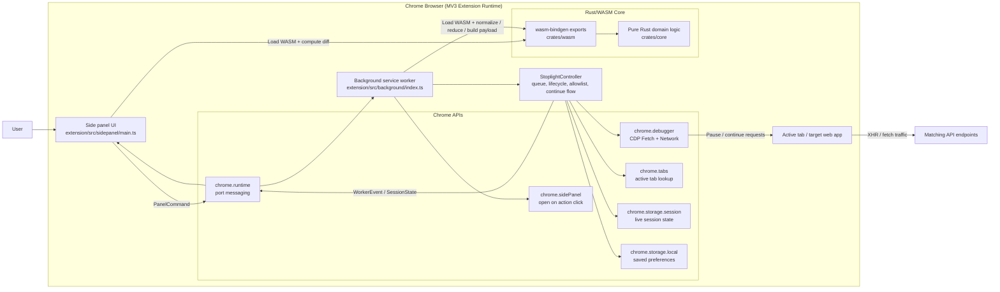
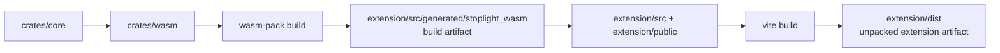

# Stoplight Architecture

Stoplight is a Chrome MV3 extension with a thin TypeScript shell around Chrome APIs and a Rust/WASM core for request-domain logic.

## Runtime Architecture

## Responsibility Split

- `extension/src/sidepanel/main.ts`
  - Renders the side panel UI.
  - Sends commands such as arm, detach, continue, play all, and allowlist updates.
  - Computes request diffs through the WASM bridge.
- `extension/src/background/index.ts`
  - Boots the MV3 background worker.
  - Binds `chrome.runtime` ports early.
  - Wires Chrome debugger events into the controller.
- `extension/src/background/controller.ts`
  - Owns session lifecycle, queue state, allowlist handling, request pausing, and continue behavior.
  - Persists live state to `chrome.storage.session` and preferences to `chrome.storage.local`.
- `crates/core`
  - Owns request normalization, body decoding, diffing, continue-payload building, and session reduction.
- `crates/wasm`
  - Exposes the Rust core to the extension through `wasm-bindgen`.

## Build Architecture

## Data Flow Summary

1. The user opens Stoplight from the toolbar and arms the current tab.
2. The side panel sends a command to the background worker over `chrome.runtime`.
3. The background controller attaches to the active tab via `chrome.debugger` and enables CDP `Fetch`/`Network`.
4. Matching requests are paused before send.
5. The controller normalizes request data through the Rust/WASM core and stores session state.
6. The side panel renders queued requests, lets the user edit headers/body, and sends continue actions.
7. The background uses the Rust/WASM core to build the continue payload, then resumes the request through CDP.
